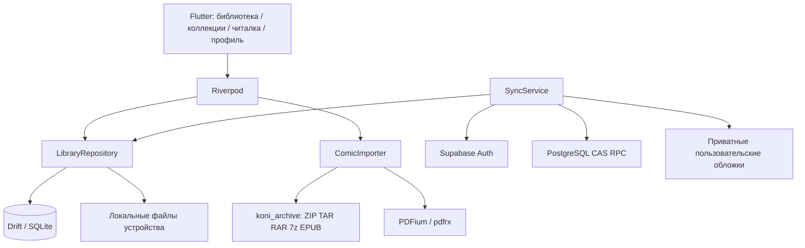

# Архитектура

## Границы приложения

Одна Flutter-кодовая база и четыре нативные оболочки. На широком экране — постоянная боковая навигация; на телефоне — нижняя панель. Компоненты оформления принадлежат приложению, системные окна выбора файлов остаются нативными.

| Путь | Ответственность |
|---|---|
| `lib/app` | Запуск, зависимости, тема |
| `lib/core/database` | Локальная схема и миграции |
| `lib/features/library/domain` | Выпуск, серия, коллекция, прогресс |
| `lib/features/library/data` | Транзакции, outbox, слияние удалённых записей |
| `lib/features/library/presentation` | Адаптивная библиотека, коллекции и порядок |
| `lib/features/importing` | Копирование файлов, SHA-256, извлечение страниц |
| `lib/features/reader` | Страницы, масштабирование, PDF, клавиатура |
| `lib/features/profile` | Вход и выбор версии при конфликте |
| `lib/features/sync` | Обмен метаданными и обложками |
| `supabase` | Серверная миграция и тесты изоляции |
| `tool/ci` | Сборка, упаковка и проверка релиза |

## Данные и идентичность

`issue` ссылается на одну серию через `seriesId`. `collection` содержит множество `seriesIds` и отдельную последовательность `readingOrder` из ID выпусков. Порядок не меняет принадлежность выпуска серии. Серия может входить в несколько коллекций. `progress` — самостоятельная запись, чтобы чтение не конфликтовало с переименованием или сменой обложки.

ID импортированного выпуска — UUIDv5 от SHA-256 содержимого. Переименование файла не создаёт другой выпуск, одинаковый файл на разных устройствах связывается с одним прогрессом. Другие редакции/сканы с другим содержимым считаются отдельными выпусками.

Первая схема хранит типизированные доменные сущности как версионируемые JSON-объекты в `library_entities`. Такое представление позволяет одинаково передавать доменные записи и добавлять поля без переписывания протокола. Связи проверяются уровнем домена. При появлении публичного каталога для него нужны отдельные нормализованные таблицы; пользовательская библиотека не является общим каталогом.

Локальная схема содержит три таблицы:

- `library_entities`: переносимые метаданные и последняя подтверждённая серверная ревизия;
- `pending_mutations`: последняя неподтверждённая операция для каждой сущности;
- `local_documents`: пути к исходнику, извлечённым страницам и локальной обложке.

Во всех первичных ключах есть `owner`. Гостевой профиль использует `local`; аккаунт — UUID Supabase Auth. Смена аккаунта не переиспользует очередь или файлы другого владельца. Гостевая библиотека не переносится автоматически в аккаунт.

## Синхронизация

1. Изменение сущности и создание новой `mutationId` записываются в одной SQLite-транзакции.
2. Через 2 секунды после изменения, при входе и каждые 45 секунд активного сеанса запускается обмен. Без интернета очередь остаётся на диске.
3. RPC `apply_library_mutation` берёт блокировку по владельцу и ID. Она сравнивает `base_revision`, увеличивает серверную ревизию и возвращает запись. Повтор той же последней `mutationId` идемпотентен.
4. Подтверждение удаляет только отправленную операцию. Если во время запроса пользователь снова изменил запись, новая операция остаётся в очереди и использует подтверждённую ревизию.
5. Если ревизии разошлись, локальная запись сохраняется, а профиль предлагает выбрать локальную или облачную версию. Прогресс не объединяется через `max(page)`: это мешало бы перечитыванию.
6. Загрузка облачных записей идёт страницами по ID. Грязные локальные записи не перезаписываются. В первой версии выполняется полный обход метаданных; для больших библиотек следующий шаг — серверный журнал изменений с курсором.

Пользовательские обложки загружаются в приватный bucket перед отправкой ссылки на них. Исходные архивы и абсолютные пути не синхронизируются. Синхронизация работает, пока приложение запущено; фоновые задания iOS/Android ещё не реализованы.

## Импорт и чтение

ZIP/TAR обрабатываются в отдельном isolate; исходник хэшируется потоком. При распаковке выходные имена создаёт приложение, пути из архива не используются. В первой версии ограничение исходника — 512 МБ, до 2000 страниц, до 50 МБ на изображение и 1 ГБ суммарно извлечённых изображений. Это ограничения первой реализации, а не обещание поддержки любого архива.

Импорт индексирует архив через koni_archive и сохраняет ссылки `archive:<entry>` вместо всех извлечённых страниц. При импорте материализуется только обложка, которая копируется за пределы воспроизводимого кэша. Читалка извлекает текущую и соседние страницы в isolate; повторные одновременные запросы одной страницы объединяются. Выходной файл получает имя по индексу, а не по пути внутри архива. Дисковый кэш удаляет старые файлы по времени использования; бюджет 256 МБ применяется после чтения, есть ручная очистка. Исходники и обложки не являются кэшем.

EPUB разбирает container.xml → OPF → manifest/spine → XHTML; текст и изображения следуют порядку элементов. Текстовые разделы сохраняются в локальном индексе как `epubtext:<base64>`. CSS, DRM, скрипты и SVG-страницы не воспроизводятся. PDF рендерит PDFium, включая миниатюры; координаты раскладки вычисляются отдельно для страницы, разворотов и вертикального режима.

`readingList` хранит собственные `readingOrder` и `completed`. Удалённые выпуски не отображаются, но их ID остаются в маршруте для восстановления после повторного импорта. `bookmarks` хранит номера страниц выпуска; `settings` — тему, размер обложек и настройки чтения. Все три вида синхронизируются тем же CAS-протоколом; миграция 002 добавляет допустимые серверные типы. Локальная схема SQLite не меняется.

Гостевая библиотека переносится по явной кнопке: копирование файлов в каталог владельца предшествует сохранению метаданных. Существующие ID аккаунта не перезаписываются, гостевые записи остаются. Повтор продолжает перенос пропущенных записей.

Настольный updater получает опубликованные GitHub Releases по HTTPS, сравнивает номер сборки, загружает платформенный ZIP и проверяет SHA-256 из release.json. Установка запускается только после выбора пользователя. Помощник дожидается завершения старого процесса, сохраняет предыдущие файлы, устанавливает новую версию и запускает приложение. macOS дополнительно проверяет code signature; Release-оболочка для прямого распространения не использует App Sandbox, поскольку помощник заменяет app bundle. Магазинный вариант потребует отдельной конфигурации. Закрытые сертификаты не входят в приложение: CI использует временные keychain/certificate store и отдельные GitHub Secrets.

## Доступ и тестирование

Сервер получает владельца из `auth.uid()`, а не из запроса клиента. RLS разрешает чтение только своих записей. Прямые записи в таблицу закрыты; изменения проходят через CAS RPC с фиксированным пустым `search_path`. Storage ограничен папкой UUID владельца.

Покрыты гонка edit/ack, сохранение грязных записей, изоляция аккаунтов, порядок коллекций, перечитывание, безопасные пути распаковки, идентичность файлов, мобильная/десктопная компоновка и целостность релизных артефактов. PostgreSQL-тесты проверяют RLS, RPC, конфликты и повтор операции. Проверки на реальных устройствах Apple выполняются после подключения соответствующей среды/подписи.
